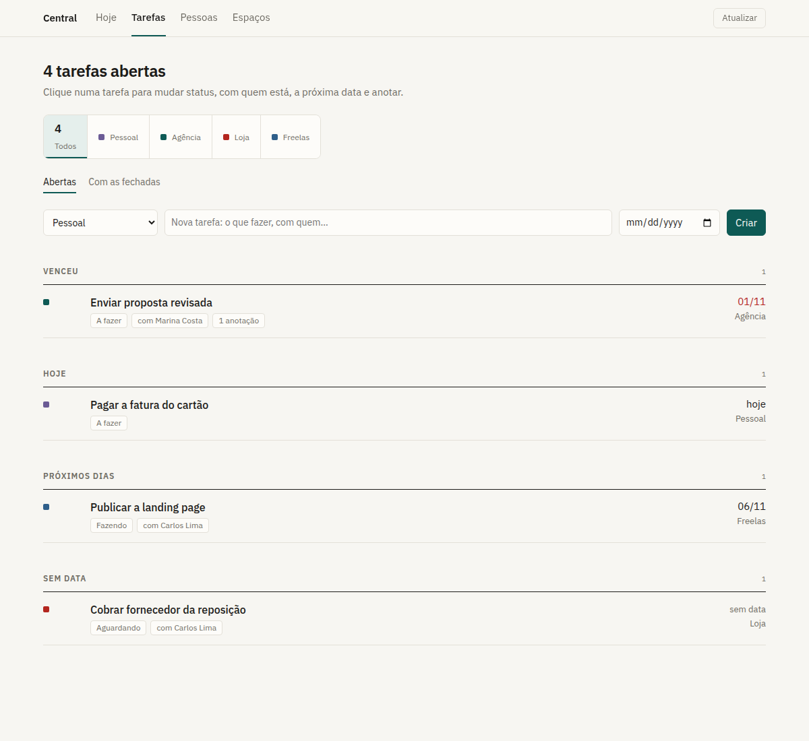
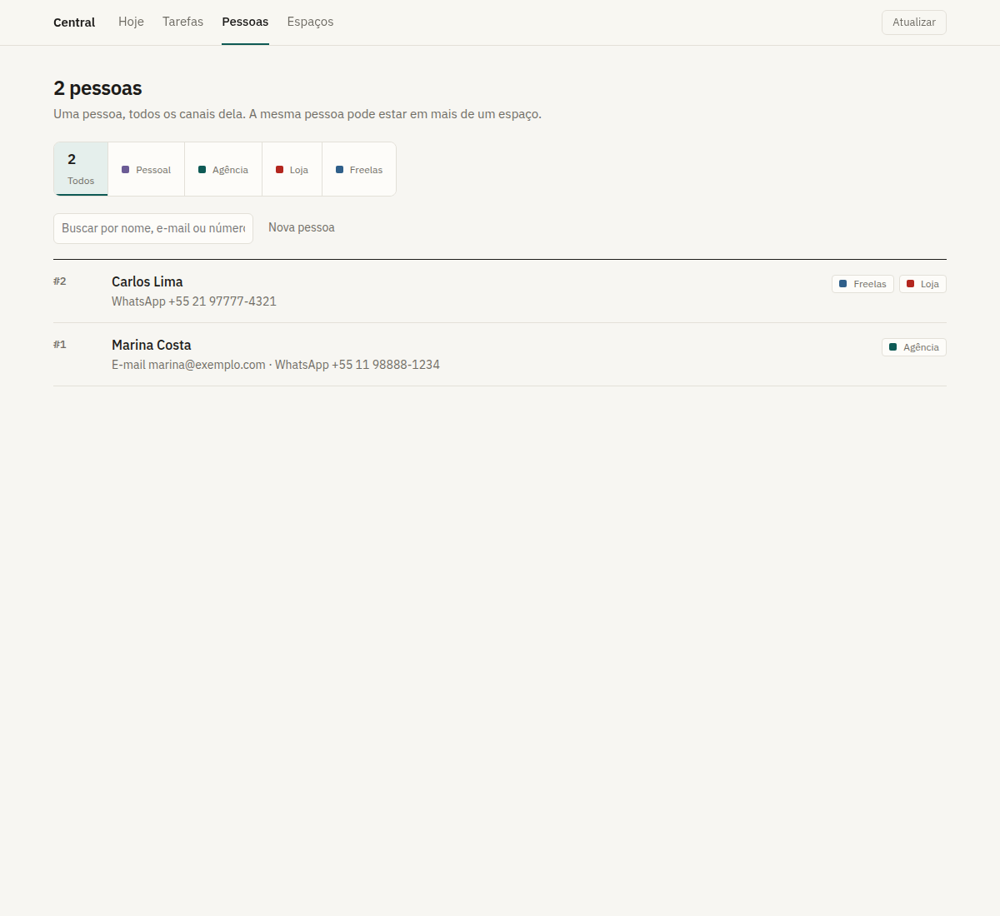

# Central

**O seu dia inteiro numa tela só, com cada empresa no seu lugar.**

Quem trabalha em mais de uma frente (o emprego, um negócio próprio, os freelas
e a vida pessoal) acaba com tarefas espalhadas em cinco lugares e contatos
misturados entre todos eles. A Central junta tudo numa tela, mas separado em
**espaços**: cada espaço tem as próprias tarefas, pessoas e fontes, e um não
enxerga o outro.


[](https://github.com/Jhonzw/central/actions/workflows/testes.yml)


---

## O que ela faz

| | |
|---|---|
| **Hoje** | Um bloco por espaço com o que venceu, o que é para hoje e o que cada sistema ligado diz que pede ação, com link direto. |
| **Tarefas** | Status, com quem está, próxima data (com atalhos) e anotações datadas. Agrupadas em venceu, hoje, próximos dias, sem data e fechadas. |
| **Pessoas** | Uma pessoa com todos os canais dela (e-mail, WhatsApp, telefone). A mesma pessoa pode estar em vários espaços. A busca acha pelo nome ou por um pedaço do número. |
| **Espaços** | Um por empresa ou vida, com nome e cor. Espaço não se apaga, só se arquiva. |
| **Fontes** | Qualquer sistema seu aparece no Hoje se expuser um JSON simples (veja [Ligar um sistema](#ligar-um-sistema-seu)). |

<table><tr>
<td></td>
<td></td>
</tr></table>

## Princípios

- **Separação de verdade.** Todo dado de trabalho pertence a um espaço. Uma
  tarefa só aceita como responsável alguém ligado ao mesmo espaço, então um
  contato de um cliente não acaba amarrado numa tarefa de outra empresa.
- **Nada sai sem você mandar.** As fontes são só lidas. Enviar mensagem ou
  e-mail, quando existir, vai ser sempre manual e com confirmação.
- **O banco é a verdade.** Toda escrita deixa uma linha em `alteracoes`, na
  mesma transação: é o histórico de tudo o que mudou.
- **Local primeiro.** Roda na sua máquina, num arquivo SQLite que só o seu
  usuário lê. Nada vai para a nuvem.
- **Zero dependências.** Node 24 puro: o SQLite é o `node:sqlite` embutido e o
  TypeScript roda direto, sem build. `git clone` e pronto.

## Começar

Precisa de **Node 24** ou mais novo.

```sh
git clone https://github.com/Jhonzw/central.git
cd central
cp config/local.example.json config/local.json   # seu nome, seus espaços e fontes
node src/server.ts                               # abre em http://localhost:7800
```

Para ver uma fonte funcionando, suba o painel de exemplo em outro terminal. O
`local.example.json` já aponta para ele:

```sh
node exemplos/painel-exemplo.ts
```

Testes:

```sh
node --test test/*.test.ts
```

## Configuração

`config/local.json` fica **fora do git**, e é nele que entram os nomes reais
das suas empresas.

```json
{
  "nome": "Ana",
  "porta": 7800,
  "espacos": [
    { "id": "pessoal", "nome": "Pessoal", "cor": "#6b5b95" },
    { "id": "empresa-a", "nome": "Empresa A", "cor": "#0e5a55" }
  ],
  "conectores": [
    { "id": "painel-a", "espaco": "empresa-a", "tipo": "resumo-http",
      "nome": "Painel da Empresa A", "url": "http://localhost:7899/api/resumo" }
  ]
}
```

Os espaços da lista são criados na primeira vez que o servidor sobe. Depois
disso, é só editar pela aba **Espaços**.

| Variável | Para quê |
|---|---|
| `CENTRAL_PORTA` | Troca a porta (padrão `7800`). |
| `CENTRAL_BANCO` | Caminho do arquivo SQLite (padrão `data/central.sqlite3`). |
| `CENTRAL_CONFIG` | Caminho de outro `local.json`. |

## Ligar um sistema seu

O conector `resumo-http` lê qualquer endereço **local** que responda isto:

```http
GET /api/resumo
```

```json
{
  "itens": [
    { "titulo": "3 pedidos aguardando aprovação", "desc": "O mais antigo é de ontem.",
      "qtd": 3, "urgente": true, "link": "http://localhost:7899/pedidos" }
  ]
}
```

- `urgente: true` sobe o item para o topo do espaço e marca em vermelho.
- `link` só vale se for `http(s)`. Qualquer outra coisa é descartada.
- Por segurança, o conector só aceita URL de loopback (`localhost`,
  `127.0.0.1`). Uma fonte fora do ar não derruba a tela: a Central mostra o
  erro e a última leitura boa.

[`exemplos/painel-exemplo.ts`](exemplos/painel-exemplo.ts) é um modelo
completo em 20 linhas.

## Segurança

- Escuta só em `127.0.0.1`.
- Requisição com `Host` que não seja local recebe **421** (proteção contra DNS
  rebinding).
- Toda escrita exige o cabeçalho `X-Central: 1`. Uma página qualquer aberta no
  navegador não consegue mandar esse cabeçalho sem passar pelo preflight de
  CORS, que este servidor não libera.
- O banco é criado com permissão `600`, numa pasta `700`.

Achou um problema de segurança? Abra uma issue sem detalhes do ataque, que eu
entro em contato.

## API

Toda resposta é JSON. A escrita precisa de `Content-Type: application/json` e
`X-Central: 1`.

| Método | Caminho | |
|---|---|---|
| `GET` | `/api/hoje` | O dia, espaço por espaço (`?forcar` relê as fontes). |
| `GET` `POST` | `/api/espacos` | Lista (`?todos` inclui os arquivados), cria ou atualiza. |
| `GET` `POST` | `/api/pessoas` | Lista (`?espaco=`, `?q=`) ou cria. |
| `GET` `PUT` `DELETE` | `/api/pessoas/:id` | Uma pessoa. O `PUT` regrava espaços e canais. |
| `GET` `POST` | `/api/tarefas` | Lista (`?espaco=`, `?pessoa=`, `?todas`) ou cria. |
| `GET` `PATCH` | `/api/tarefas/:id` | Uma tarefa. O `PATCH` aceita `nota` para anotar e `apagarAnotacao`. |

## Estrutura

```
src/
  server.ts          HTTP, rotas e travas
  db.ts              SQLite, migrações, transação e registro de alterações
  espacos.ts · pessoas.ts · tarefas.ts · hoje.ts
  conectores/        um arquivo por tipo de fonte
  web/index.html     a tela (HTML + CSS + JS, sem framework)
migrations/          o esquema, aplicado em ordem
exemplos/            painel de exemplo para o conector
test/                node:test, inclusive com o servidor de verdade
```

## Próximos passos

- [ ] **E-mail só leitura**: Gmail com `gmail.readonly` e IMAP. Triagem do que
      precisa de resposta, ligada à pessoa e ao espaço.
- [ ] **WhatsApp**: leitura e nota interna por conversa, que nunca vai para o
      WhatsApp.
- [ ] **MCP**: um assistente de IA consulta a Central direto da conversa.
- [ ] **Notas Markdown geradas** (Obsidian) a partir do banco.
- [ ] Envio manual, com confirmação.

Ideias e PRs são bem-vindos. Abra uma issue antes de uma mudança grande, para a
gente alinhar o caminho.

## English

**Central** is a local-first, zero-dependency personal hub for people who
juggle several jobs or companies. Everything lives in separate *spaces*
(personal, each company, freelance work), each with its own tasks, people and
read-only data sources, and the **Today** view gathers what needs action across
all of them. It runs on Node 24 with the built-in `node:sqlite` and native
TypeScript, with no build step and no `npm install`. The UI and the code
comments are in Portuguese. To plug in your own system, expose
`GET /api/resumo` as shown above.

## Licença

[MIT](LICENSE) © Jhonzw
