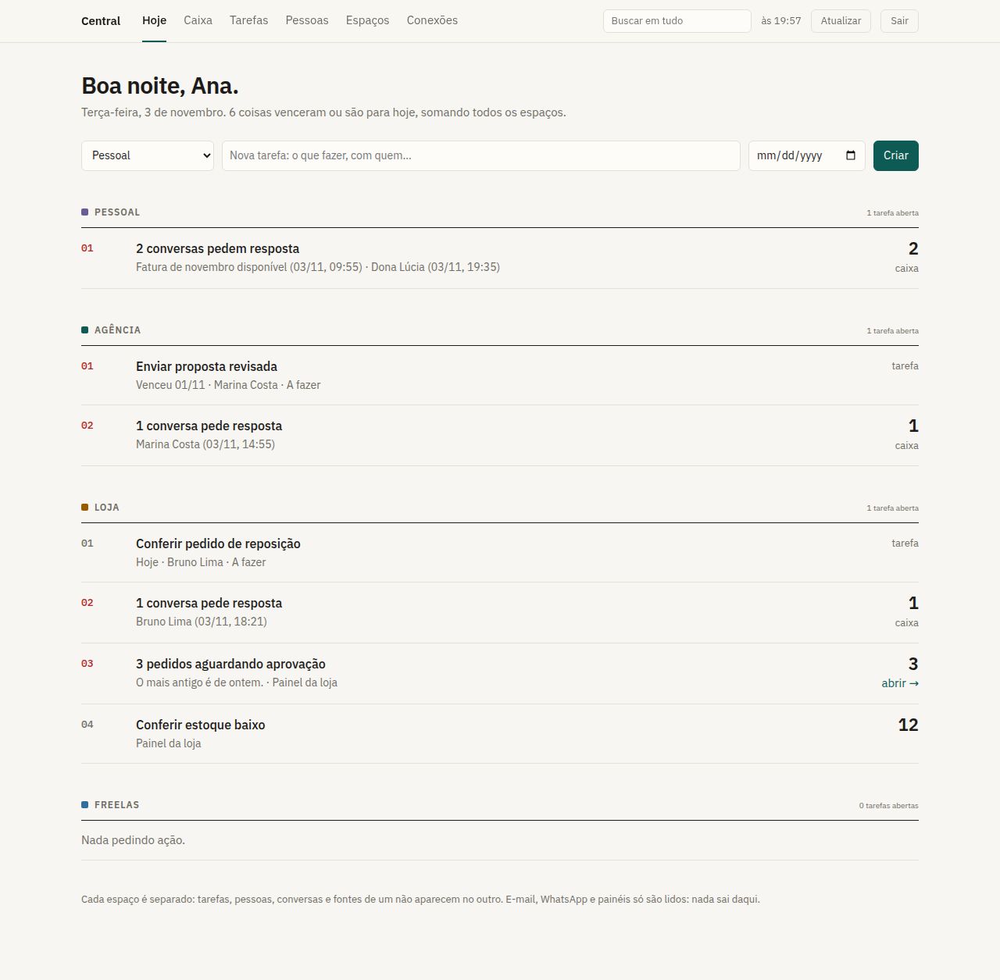
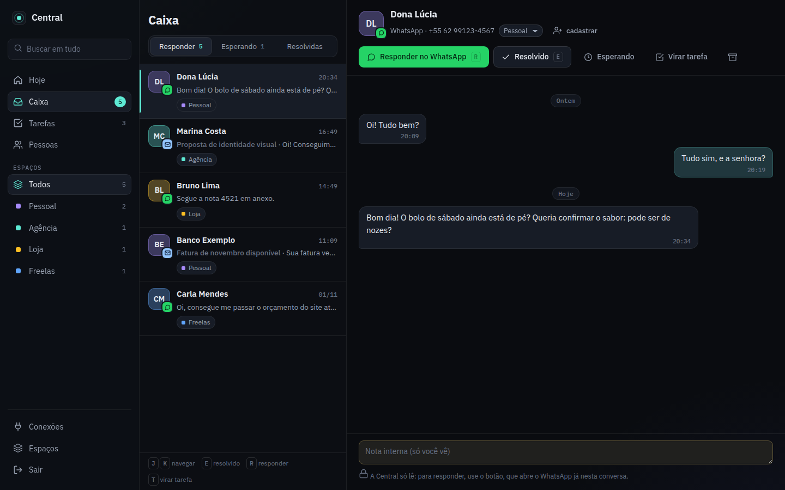
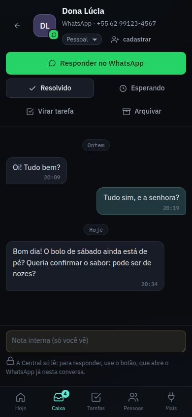
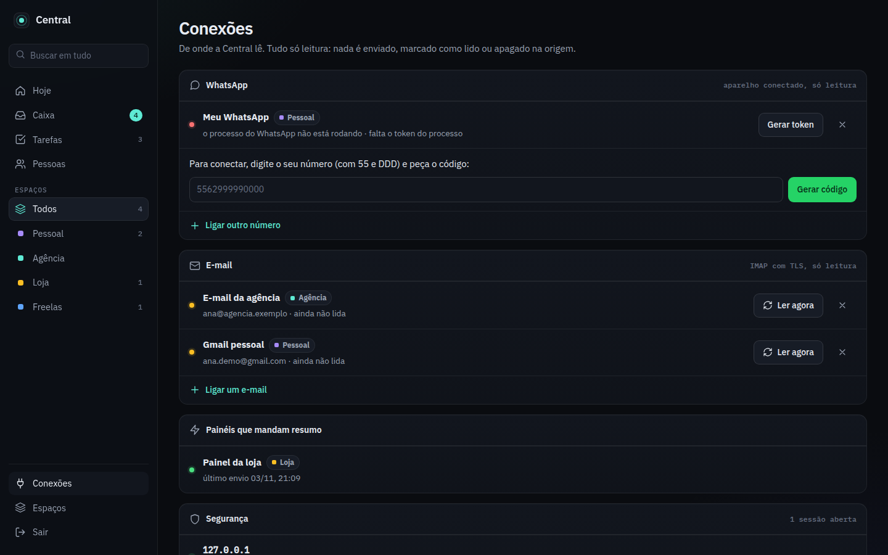

# Central

**O seu dia inteiro numa tela só, com cada empresa no seu lugar.**

Quem trabalha em mais de uma frente (o emprego, um negócio próprio, os freelas
e a vida pessoal) acaba com tarefas em cinco lugares, e-mails em três caixas e
o WhatsApp misturando cliente com família. A Central junta tudo numa tela, mas
separado em **espaços**: cada espaço tem as próprias tarefas, pessoas,
conversas e fontes, e um não enxerga o outro.



[](https://github.com/Jhonzw/central/actions/workflows/testes.yml)


---

## O que ela faz

| | |
|---|---|
| **Hoje** | Quatro números que se clicam (para responder, esperando, atrasadas, para hoje), a fila de quem espera resposta com há quanto tempo, as tarefas do dia com caixinha de concluir e um cartão por espaço com o que cada sistema ligado pede. |
| **Caixa** | E-mail e WhatsApp juntos, no jeito de um app de mensagens: lista à esquerda, conversa em balões à direita. **Responder** abre o WhatsApp ou o Gmail já naquela conversa (a Central não envia nada); **Resolvido** passa para a próxima, com desfazer. Respondeu pelo celular, a conversa vai sozinha para “esperando”. Nota interna, virar tarefa, mover de espaço e atalhos de teclado (J/K/E/R/T). |
| **Tarefas** | Criar com Enter, concluir na caixinha, detalhar numa gaveta lateral: situação, com quem está, quando e anotações datadas. |
| **Projetos** | Objetivo, próximo passo, prazo, notas e tarefas em lista ou quadro. As mensagens relacionadas acompanham o projeto. |
| **Pessoas** | Uma pessoa com todos os canais (e-mail, WhatsApp, telefone), em um ou mais espaços. A conversa nova se liga à pessoa pelo e-mail ou pelo número, mesmo quando o celular vem sem o 9. |
| **Busca** | Em mensagens, tarefas e pessoas, sem acento e sem diferença de maiúscula. |
| **Conexões** | Caixas IMAP, números de WhatsApp, painéis que mandam resumo, tokens e as sessões abertas. |
| **MCP** | Um assistente de IA consulta a Central direto da conversa, só lendo. |



<table><tr>
<td width="32%"></td>
<td></td>
</tr></table>

## Princípios

- **Separação de verdade.** Todo dado de trabalho pertence a um espaço. Uma
  tarefa só aceita como responsável alguém do mesmo espaço.
- **Nada sai daqui.** E-mail, WhatsApp e painéis são só lidos. A Central não
  tem rota de envio, e o processo do WhatsApp não tem chamada de envio. Um teste
  falha se alguém puser uma.
- **O banco é a verdade.** Toda ação do dono deixa uma linha em `alteracoes`.
  As notas do Obsidian são geradas a partir dele.
- **Guardar pouco.** De cada mensagem fica só um trecho do texto, que é apagado
  depois de 90 dias (dá para mudar). Anexo e HTML nunca entram.
- **Leve.** O núcleo é Node 24 puro: o SQLite é o `node:sqlite` e o TypeScript
  roda direto, sem build e sem `npm install`. Só o processo do WhatsApp tem
  dependência (Baileys).

## Começar

Precisa de **Node 24** ou mais novo.

```sh
git clone https://github.com/Jhonzw/central.git
cd central
cp config/local.example.json config/local.json   # seu nome, seus espaços e fontes
node src/server.ts                               # http://localhost:7800
node src/admin.ts convite                        # link de uso único para criar a senha
```

Abra o link do convite e escolha a senha. Depois, adicione a chave mostrada no
seu autenticador (Google Authenticator, Aegis, 1Password) e confirme com um
código. Daí em diante, entrar pede **senha e código**.

Testes: `node --test test/*.test.ts`. Os testes do WhatsApp rodam com
`cd whatsapp && npm ci && cd .. && node --test whatsapp/*.test.ts`.

### Organizar o trabalho

Escolha um espaço e crie um projeto. Uma tarefa pode ser capturada com Enter e
organizada depois no filtro **Sem projeto**. Na ficha, separe o dia planejado,
o prazo de entrega e o lembrete; use descrição, prioridade e checklist quando
precisar. A vista Quadro usa as mesmas tarefas da lista.

Na Caixa, cada mensagem oferece **Criar tarefa** ou **Vincular tarefa**. Assim,
um e-mail e um WhatsApp podem complementar a mesma tarefa daquele espaço.
**Mensagens de origem**, na tarefa, abre a conversa no trecho correto. Criar
tarefa não envia resposta nem conclui a conversa.

Use **A triar**, **Responder**, **Esperando**, **Cobrar**, **Adiados** e
**Todos / Arquivados** para processar entradas. Adiar oculta a pendência até
a data escolhida; nova mensagem reabre. Marcar visto ou arquivar altera apenas
a Central. Filtros por canal, conta e projeto podem ser salvos no navegador.
O histórico da pessoa aparece na sua ficha, limitado ao espaço selecionado.

### Trabalho local na mesma interface

O [gateway local](docs/operacao-local.md) oferece uma entrada autenticada no
notebook com **Trabalho local** e **Central pessoal**. A operação aparece
dentro da Central; projetos e tarefas locais usam outro banco SQLite e nunca
são enviados à VPS. Trocar a origem troca também o conjunto de espaços:
“Todos” agrega somente a origem atual. Detalhes externos exigem acesso privado
configurado; não há publicação automática dos sistemas locais.

O gateway permanece desativado até configurar fontes e autenticação. A versão
pública mostra apenas o resumo permitido e informa quando os detalhes precisam
da entrada local. Nenhuma integração real é habilitada pelos testes.

### Testar no navegador

```sh
npm ci
npx playwright install chromium
npm run test:e2e
```

Os testes iniciam Central, gateway e fonte fictícia com bancos descartáveis.
Exercitam mensagem → tarefa → projeto → origem, celular, operação local e
concorrência. O CI também executa esses percursos e guarda traces de falhas
somente com dados fictícios.

## Segurança

Juntar e-mail e WhatsApp de várias empresas num lugar cria um alvo valioso.
Por isso a Central é fechada por padrão.

| Risco | O que a Central faz |
|---|---|
| Alguém tentando entrar | Senha (scrypt) e código TOTP, e o mesmo código não vale duas vezes. Depois de 5 erros, o IP trava por 15 min; com 30 erros no total, trava tudo. A sessão fica no servidor e dá para derrubar todas. |
| Ler o banco ou o backup | Senha de e-mail, segredo do TOTP e sessão do WhatsApp ficam cifrados (AES-256-GCM), com a chave em outro arquivo. Sessão, convite e token ficam só como hash. |
| XSS | CSP só com o hash do script da página. Todo texto de terceiro é escapado, a página não carrega nada de fora (as fontes vêm do próprio servidor) e o cookie é `HttpOnly`. |
| CSRF / outra página | Cookie `SameSite=Strict` mais o cabeçalho `X-Central` obrigatório na escrita. |
| DNS rebinding | Lista de `Host` aceitos; os demais recebem **421**. |
| Servidor IMAP malicioso ou interno | Só TLS na porta 993, com certificado conferido. Endereço interno (loopback, rede privada, metadados da nuvem) é recusado. A pasta é aberta com `EXAMINE` e o corpo lido com `BODY.PEEK`, então nada é marcado como lido. |
| Mensagem com instrução para a IA (*prompt injection*) | O MCP usa um token `leitura`, com o qual a Central não deixa escrever. Ele não tem ferramenta que envia ou apaga, e o texto de terceiros volta marcado como dado. |
| Bloqueio do WhatsApp | Só leitura: não fica "online", não marca como lida e não envia. Grupos ficam de fora por padrão. Mesmo assim, é uma via não oficial: use num número seu. |

Achou um problema de segurança? Abra uma issue sem os detalhes do ataque, que
eu entro em contato.

## Conectar

### E-mail (IMAP)
Na aba **Conexões**: servidor, usuário e senha. No Gmail, use uma
[senha de app](https://myaccount.google.com/apppasswords). A Central lê a cada
5 minutos (`emailMinutos`). Na primeira leitura, vêm só os últimos 14 dias.

### WhatsApp
O processo em [`whatsapp/`](whatsapp) roda separado e entrega as mensagens à
Central com um token que vale só para aquela conta.

```sh
node src/admin.ts whatsapp meu-whats pessoal whatsapp-token   # cria a conta e o token
cd whatsapp && npm ci
CENTRAL_URL=http://localhost:7800 CENTRAL_TOKEN_ARQ=../whatsapp-token CONTA=meu-whats \
  SESSAO=./sessao CHAVE_ARQ=./chave node processo.ts
```

Na aba Conexões, digite o seu número e clique em **Parear**. O código aparece
na tela. No celular, vá em *Aparelhos conectados → Conectar com número de
telefone* e digite o código.

### Um sistema seu
Qualquer sistema aparece no Hoje respondendo `{ "itens": [{ "titulo", "desc", "qtd", "urgente", "link" }] }`. Há dois jeitos:

- `resumo-http`: a Central lê um endereço **local** (`GET /api/resumo`). Veja
  [`exemplos/painel-exemplo.ts`](exemplos/painel-exemplo.ts).
- `resumo-push`: o sistema **manda** para a Central, com um token
  `fonte:<id>`. Serve quando o sistema está numa rede que a Central não alcança:
  ```sh
  curl -X POST https://central.exemplo.com/api/ingest/resumo/painel-b \
    -H "Authorization: Bearer $TOKEN" -H 'Content-Type: application/json' \
    -d '{"itens":[{"titulo":"3 pedidos parados","qtd":3,"urgente":true}]}'
  ```

Link só vale se for `http(s)`. Fonte calada há mais de 20 min aparece com
aviso, e a última leitura continua na tela.

### MCP (Claude e outros)
Gere um token de leitura em Conexões e registre o servidor:

```sh
claude mcp add central -e CENTRAL_URL=http://localhost:7800 -e CENTRAL_TOKEN_ARQ=$HOME/.central-token \
  -- node /caminho/central/mcp/central-mcp.ts
```

As ferramentas são `hoje`, `buscar`, `tarefas`, `pessoas`, `conversas` e
`conversa`, todas de leitura.

### Obsidian
```sh
CENTRAL_TOKEN_ARQ=$HOME/.central-token node ferramentas/exportar-obsidian.ts "/caminho/Vault/Central"
```
Gera uma nota por espaço com as tarefas abertas, as conversas pedindo
resposta e as pessoas. Não leva texto de mensagem nem telefone.

## Rodar num servidor

[`deploy/`](deploy) tem as imagens e um `compose.yml` pensado para dividir a
máquina com outros sistemas:

- teto de **256 MB / 0,5 CPU** para a Central e de **512 MB / 0,5 CPU** para o
  WhatsApp, com `cpu_shares` baixo, para que na disputa os outros ganhem;
- usuário sem privilégio (UID 10777, que não é de ninguém na máquina), sistema de arquivos só leitura, sem *capabilities* e
  porta só em `127.0.0.1`;
- [`nginx-central.conf`](deploy/nginx-central.conf) com limite de tentativas
  de login e a entrada do WhatsApp fechada para a internet.

```sh
mkdir -p /opt/central/{dados,config,segredos,whatsapp}
openssl rand -base64 32 > /opt/central/segredos/chave      # chave do cofre
chown -R 10777:10777 /opt/central/{dados,segredos,whatsapp} && chmod 600 /opt/central/segredos/*
cp config/local.example.json /opt/central/config/local.json
docker compose -f deploy/compose.yml up -d --build
docker exec central node src/admin.ts convite
```

**Domínio próprio ou caminho dentro de um site.** O melhor é um subdomínio só
da Central (`central.seu-dominio`, com `nginx-central.conf`): é outra origem, e
nada mais no servidor alcança a sessão. Se não der para mexer no DNS, ela roda
em `https://seu-dominio/central/` com
[`nginx-central-caminho.conf`](deploy/nginx-central-caminho.conf) e
`CENTRAL_BASE=/central`. Aí o cookie fica preso a `/central/` e os outros sites
do domínio nem o recebem, mas é a mesma origem: um script de outro site ali
conseguiria chamar a API. Só use o caminho se os outros sites forem seus e não
carregarem script de terceiros.

```sh
# Exemplo de variáveis em /opt/central/central.env
CENTRAL_BASE=/central
CENTRAL_HTTPS=1
CENTRAL_DOMINIO=seu-dominio.com.br
docker compose --env-file /opt/central/central.env -f deploy/compose.yml up -d --build
```

Backup diário em `dados/backup/`, com 7 cópias. Guarde a chave do cofre em
outro lugar: sem ela, o backup não abre os segredos.

## Configuração

| Variável | Para quê |
|---|---|
| `CENTRAL_PORTA` | Porta (padrão `7800`). |
| `CENTRAL_ESCUTA` | Endereço (padrão `127.0.0.1`). |
| `CENTRAL_HOSTS` | Nomes aceitos no `Host`, separados por vírgula (ex.: o seu domínio). |
| `CENTRAL_PROXY` | `1` atrás de nginx: o IP vem de `X-Real-IP`. |
| `CENTRAL_HTTPS` | `1` quando servida por HTTPS (manda HSTS). |
| `CENTRAL_BASE` | Caminho quando divide o domínio com outro site (ex.: `/central`). |
| `CENTRAL_BANCO` | Arquivo SQLite (padrão `data/central.sqlite3`). |
| `CENTRAL_CHAVE_ARQ` | Chave do cofre (padrão `config/chave`, criada na 1ª subida). |
| `CENTRAL_CONFIG` | Outro `local.json`. |
| `CENTRAL_EMAIL_MINUTOS` | Intervalo de leitura do e-mail; `0` desliga. |

## Estrutura

```
src/
  server.ts          HTTP, rotas e travas
  acesso.ts          dono, convite, sessão, travas e tokens
  cofre.ts · totp.ts segredos cifrados e código do autenticador
  caixa.ts           conversas, mensagens, busca e retenção
  contas.ts · whatsapp.ts
  email/             cliente IMAP só leitura e MIME
  conectores/        fontes lidas e empurradas
  web/index.html     a tela (HTML + CSS + JS, sem framework)
whatsapp/            processo separado do WhatsApp (Baileys)
mcp/                 servidor MCP só leitura
ferramentas/         exportar para o Obsidian
deploy/              Docker, compose e nginx
migrations/ · test/
```

## Próximos passos

- [ ] Envio manual, sempre com confirmação e por canal.
- [ ] Gmail por OAuth (`gmail.readonly`), para quem não pode usar senha de app.
- [ ] Resumo da conversa sob demanda com um modelo local.
- [ ] Lembretes no celular (Web Push).

Ideias e PRs são bem-vindos. Abra uma issue antes de uma mudança grande.

## English

**Central** is a local-first personal hub for people who juggle several jobs or
companies. Everything lives in separate *spaces*, each with its own tasks,
people, email/WhatsApp conversations and data sources, and the **Today** view
gathers what needs action across all of them. It is read-only by design: IMAP
mailboxes are opened with `EXAMINE` and `BODY.PEEK`, and the WhatsApp worker
(Baileys) contains no send call (a test enforces it). Login takes a password
and TOTP. Secrets are encrypted with AES-256-GCM and a key kept outside the
database, and a read-only MCP server lets an AI assistant query it. The core
runs on Node 24 with the built-in `node:sqlite` and native TypeScript, with no
build step and no dependencies. The UI and the code comments are in
Portuguese.

## Licença

[MIT](LICENSE) © Jhonzw. Fonte IBM Plex sob a [SIL OFL 1.1](src/web/fontes/LICENSE-IBM-Plex.txt).
